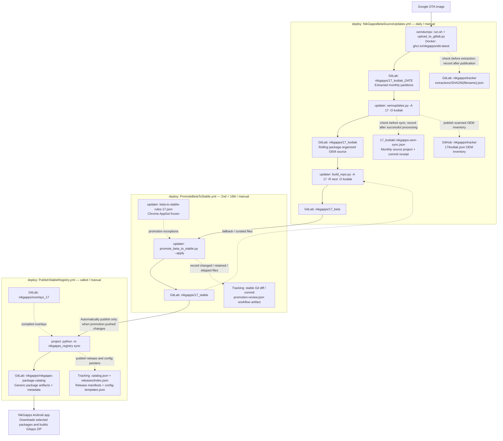

# NikGapps deployment pipeline

## Android 17 complete stable release

Run **Actions → NikGapps Android 17 Release → Run workflow**. This manual workflow
publishes Android 17 registry packages and app release metadata, builds signed
Core/CoreGo and all other predefined packages/addons from that exact registry
release, uploads them to SourceForge, records confirmed download links in GitLab
metadata, and then updates the website changelog and
release/config trackers. Caching and onDemand are not part of this flow.

Enable **verify_only** to build and validate the full selection on Linux without
publishing. Both modes first compile all overlay source targets in one shared
release-engine pass, then exercise real Core/CoreGo APKs through raw-source
and local-registry assembly and compare their outputs. The gate verifies generated
permission XML, package IDs, binary hashes, merged support, Go files and installer
size accounting. The same SDK aapt2 inspects APKs during publication and final ZIP
assembly; inspection failures cannot be converted into successful release ZIPs.

**Android 17 release workflow checks** runs syntax/contract tests automatically.
Run it manually to also verify the actual `G_TOKEN` private checkout, myenv import,
GitHub publication permissions and GitLab source/catalog roles. This preflight
does not upload packages, change metadata, log in to SourceForge or push files.

The code and changelog are maintained in the private
[`nikhilmenghani/nikgapps-release`](https://github.com/nikhilmenghani/nikgapps-release)
repository. Edit its **`changelogs.yaml`**, commit and push to `main`. The workflow
automatically checks out the latest `main` using `RELEASE_REF`; no release SHA
update in deploy is needed. It records the resolved commit in the Actions summary
and reads the builder pin directly from that checkout's `builder-pin.json`.
Use the full tested/pushed `17_stable` SHA as `stable_commit` and the tested/pushed
`overlays_17_source` SHA as `overlay_source_commit`. The source checkout is copied
into the run workspace and compiled with the pinned official apktool (currently
3.0.3); its download is SHA-256 verified. Pixel Launcher's framework and color
APKs are built alongside every other overlay and included together in its payload.
The release uses these new APKs directly, without a compiled-overlay repository
or a separate Pixel Launcher build step. Source/tree/tool hashes and output APK
hashes are retained in overlay reports, run state and the release receipt. The initial
shared-Core SHA is `ae4bef228debce1be3f980b9bcbbcd3ab29e572b`; it includes the
known-working WebView 134 set, not uncommitted local WebView 145 files.

Only deploy's existing **`G_TOKEN`** secret is required. It checks out the private
release code, reads `nikhilmenghani/myenv/.env` as data, and authenticates GitHub
tracker/website pushes. The loader maps `NIKGAPPS_GITLAB_TOKEN` to `GITLAB_TOKEN`
and `USER_EMAIL` to `EMAIL`, and imports `SF_PWD` and `USER_NAME`. It masks
credentials, disables interpolation, and never executes myenv code. GitLab
source clones and GitHub pushes use HTTPS askpass with host-specific credentials;
no SSH private key or duplicated release-repository secrets are needed. Optional
variables are `GITLAB_CATALOG_PROJECT_ID` and `SF_USER`.

The complete release and `PublishStableRegistry.yml` share the
`stable-registry-publication` lock. Other Android versions continue using the
existing **NikGapps Release** workflow. Registry publication happens first; if a
later upload fails, the app metadata may already be published. Check the Actions
summary and retained receipts before retrying.

Confirmed downloads are stored under `sourceforge` in the existing GitLab registry
release manifest (`85036487`). The website follows the existing `releases/index.json`
and reads `sourceforge.files`; no second website copy or download index is maintained.
Entries contain published URLs, file sizes and hashes alongside the same app release.
Production GitHub artifacts retain only metadata, config, checksums and receipts;
release ZIPs are excluded because they are already stored on SourceForge.
`verify_only` uploads no artifacts; inspect its Actions summary for the source/tool
hashes, overlay count and confirmation of both overlays in Pixel Launcher's ZIP.

To backfill or retry download indexing for an existing upload, run **Sync
SourceForge Release Metadata** with the ISO date and exact registry release ID.
It verifies the existing manifest and all remote file sizes, publishes a derived
SourceForge link snapshot, and updates the corresponding GitLab release manifest. It does not
rebuild or republish ZIPs or app packages. A future removal workflow must withdraw
the corresponding index entry; manual SourceForge deletion needs reconciliation.

## Manual OTA extraction with the private operations engine

Run **Actions → NikGapps OTA Extraction → Run workflow**. Defaults are Android
17 and device `kodiak`; leave the build empty to discover the latest eligible
OTA, or provide an exact Google build ID. The workflow is manual and does not
change any existing scheduled pipeline.

It first discovers the selected OTA and checks the dated GitLab repository's
`ota-completion.json`: exact build ID, OTA checksum, payload directory
hashes, all report checksums and requested Telegram delivery. A verified
completed build exits successfully **before Docker setup, download or extraction**.
Code/settings changes alone do not trigger re-extraction. The **force_rerun**
checkbox (off by default) explicitly bypasses completion and inventory reuse,
then appends the replacement source snapshot to the existing branch without
rewriting history.
A matching existing source inventory can finish its missing reports without
re-extracting the OTA.

For a new build, the pinned private engine extracts and prepares the reviewed
source files and overlays, creates a private dated GitLab repository, uploads
binaries using Git LFS and verifies the remote branch. Existing unmatched payload
repositories are never overwritten. Reports include:

- `all_files.txt` and `packages.json` alongside the extracted files and in GitLab;
- `updates.json` and searchable mobile `updates.html`;
- readable `nikgapps-updates.md` and `nikgapps-updates.json`, restricted to configured
  NikGapps packages, separating higher versionCodes from same-version payloads,
  source holds, missing candidates and downgrades.

For report-code changes, enable **regenerate_reports** and leave **force_rerun**
off. This bypasses completion only for metadata regeneration: current and previous
GitLab inventories are read, upgrade reports committed, and requested Telegram
messages refreshed. Docker, OTA download, extraction, source publication and
backups are explicitly disabled. Missing inventory fails rather than falling
back to extraction. The two rerun options are mutually exclusive.

The focused Markdown report requires both a higher versionCode and changed APK
hashes to label an update required. Same-version file changes are review-only;
metadata/location-only changes do not require an APK update. The report includes
old/new versions, content-change flags and hashes.

The completion record is written only after publication, report verification and
requested private Telegram delivery. Failed work is not marked complete. Package
channels are unchanged. A first build still needs an older inventory to produce
comparison reports; absence of one fails explicitly rather than claiming success.

The production execution mode deletes the source ZIP after successful extraction.
Full TAR.XZ backups are **off by default**; opt in only when explicitly needed.
Requested backup artifacts are retained for 3 days; report artifacts for 7 days.
GitLab source and reports persist independently. The baseline namespace defaults
to `nikgapps`. Telegram uses cron's monthly-report private recipient.

Repository secret `G_TOKEN` must read the private operations and myenv repos.
The runtime data-only myenv loader requests only the GitLab and Nikhil Telegram
bot credentials it needs. Tokens never enter image layers. Because deploy is
public, only the public toolchain stage is exported to the Actions build cache;
private application layers remain on the ephemeral runner.

The preflight and metadata-only report paths use a small virtual environment
with hash-locked dependencies. A completed build skips the Docker image build,
OTA download, extraction and publication. The summary reports extraction and
GitLab publication separately so a failed upload cannot look complete.

The `OPERATIONS_REVISION` in
`.github/workflows/NikGappsOtaExtraction.yml` pins the tested engine commit.
Update that SHA deliberately when accepting another operations release.

This repository orchestrates Google OEM extraction, source preparation,
beta-to-stable promotion, and publication of the packages consumed by the
NikGapps Android app. The examples below use **Android 17 / kodiak**;
`<android>`, `<device>` and `<date>` represent the selected target and dump date.

## Pipeline diagram

Solid arrows show processing/data flow. Dotted arrows show tracking, fallback
inputs or supporting dependencies. The three workflow groups are separate runs:
daily beta preparation does **not** immediately trigger stable promotion.



The beta updater also reads the existing `17_beta` tree when comparing sources.
The diagram's stable fallback does not mean every beta package is replaced by
stable: `next` applies package-specific comparison and companion-file strategies.

## Projects and repositories

| Project | Local checkout | Role |
| --- | --- | --- |
| GitHub `NikGappsOfficial/deploy` | `D:\workspace\docker\deploy` | Workflows, orchestration and registry rollback helper. |
| GitHub `nikgapps/oemdumps` | `D:\workspace\docker\oemdumps` | OTA discovery/download, partition extraction and monthly dump publication. |
| GitHub `nikgapps/updater` | `D:\workspace\python\updater` | Rolling OEM sync, beta preparation and beta-to-stable promotion. |
| GitHub `nikgapps/project` | `D:\workspace\python\project` | NikGapps package/AppSet definitions, build logic and registry publisher. |
| `niklibrary` | `D:\workspace\python\niklibrary` | Shared Git/GitLab, source-cloning and Android platform helpers. |
| NikGapps Android app | `D:\workspace\android\NikGapps` | Consumes published metadata/artifacts and assembles user-selected ZIPs. |

The updater installs the NikGapps Python package from its `requirements.txt`;
editing the local `project` checkout alone does not change that installed
dependency. The registry publication workflow, in contrast, clones `project`
from GitHub and runs its code directly.

### GitLab source and output repositories

| Repository | Contents / purpose |
| --- | --- |
| `nikgapps/<android>_<device>_<date>` | Monthly extracted Google dump, e.g. `17_kodiak_260905`. |
| `nikgapps/<android>_<device>` | Latest package-organized OEM source, e.g. `17_kodiak`. Not a second full OTA extraction. |
| `nikgapps/<android>_beta` | Candidate packages assembled from OEM, stable fallback and existing beta sources. |
| `nikgapps/<android>_stable` | Approved source files used for stable package publication. |
| `nikgapps/overlays_<android>` | Compiled overlays used during publication. |
| `nikgapps/nikgapps-package-catalog` | Generic package artifacts, catalog, release manifests and config templates consumed by the app. Default project ID: `85036487`. |
| `nikgapps/tracker` | Successful OEM extraction receipts. Separate from the GitHub tracker described below. |

## Workflows and execution boundaries

All links in this table point to workflows in this repository. Schedules are UTC.

| Workflow | Trigger | Processing / output |
| --- | --- | --- |
| [NikGapps Beta Source Updates](.github/workflows/NikGappsBetaSourceUpdates.yml) | Daily `01:00 UTC`, or manual | Resolves separate `android_version` and `device` inputs (defaults `17` and `kodiak`); extracts/reuses the latest OTA, syncs the rolling OEM repository, then prepares beta using `next`. |
| [Promote Beta Source to Stable](.github/workflows/PromoteBetaToStable.yml) | Days **2 and 16**, `09:00 UTC`, or manual | Runs `promote_beta_to_stable.py --android-version ... --apply`; pushes stable only when changed. Calls **Publish Stable Package Registry** only when that push occurred. |
| [Publish Stable Package Registry](.github/workflows/PublishStableRegistry.yml) | Manual, or reusable workflow call | Clones `project`, `<android>_stable` and `overlays_<android>`; builds package artifacts, uploads missing registry versions and publishes metadata/config templates. Default Android version: `17`. |
| [Roll Back Stable Package Registry](.github/workflows/RollbackStableRegistry.yml) | Manual | Validates a specified immediately preceding publication and optionally restores its metadata. `apply=false` is a dry run. Does not roll back stable source files. |

Daily source preparation currently invokes:

```sh
python3 oemupdates.py -A "$ANDROID_VERSION" -O "$DEVICE"
python3 build_repo.py -A "$ANDROID_VERSION" -R next -O "$DEVICE"
```

`refresh` and `swift` exist in updater, but are **not** the beta preparation case
selected by this workflow. Also, **NikGapps Beta Release** is a separate ZIP-build
workflow; it is not responsible for preparing `<android>_beta` source repositories.

## Tracking and repeat-run behavior

| Stage | Tracking location | Repeat-run behavior |
| --- | --- | --- |
| OTA extraction | **GitLab** `nikgapps/tracker`, `extractions/<SHA256-of-filename>.json` | `run.sh` checks the resolved OTA filename before extraction. A complete receipt skips extraction. `upload_to_gitlab.py` records success only after partition publication succeeds. Tracker access/validation errors are not treated as successful extraction. |
| Rolling OEM sync | GitLab `<android>_<device>/.nikgapps-oem-sync.json` | `SyncTracker` compares the selected monthly source project ID, commit and tracking rules version. Matching completion skips the OEM sync. The receipt is written after source/inventory processing succeeds in non-dev execution. |
| OEM inventory | **GitHub** `nikgapps/tracker`, e.g. `17/kodiak.json` | Stores the scanned OEM inventory used by updater. This is not the GitLab extraction receipt repository. |
| Beta preparation | Existing beta Git contents / commits | `next` compares source packages using its strategies. There is no separate whole-stage completion receipt in this workflow; skipping extraction/OEM sync does not skip beta preparation. |
| Stable promotion | Stable Git changes and `promotion-review.json` | The report lists upgraded, removed, retained and skipped files. No stable changes means no push and no automatic publication. The report is uploaded as an Actions artifact. |
| Registry publication | Existing Generic Registry package name/version pairs; catalog and release metadata | Existing artifact versions are reused rather than uploaded again. Release manifests pin selected package versions; `releases/index.json` identifies the active release. Artifact reuse does not itself mean the whole publication stage is skipped. |

### Promotion exclusions

Updater selects `beta-to-stable-rules-<android>.json` when present; otherwise it
uses `beta-to-stable-rules.json`. These files are alternatives, not merged layers.
Both the default and Android 17 files currently freeze the `GoogleChrome` AppSet:

```json
"appSets": {
  "GoogleChrome": "keep-stable"
}
```

This retains stable Chrome, TrichromeLibrary and WebViewGoogle, including their
companion files, and skips new beta-only members of the frozen AppSet. Individual
packages can be frozen with `"AppSet/Package": "keep-stable"` in `packages`.
Do not overlap an AppSet freeze with package/file rules inside that AppSet.

These exclusions affect **beta-to-stable promotion only**. Monthly extraction,
rolling OEM sync and beta preparation can still contain newer Chrome packages.
Intentional manual edits to stable can also still be published.

### Package releases versus config versions

A new package release does not necessarily require a new config version.
Config revisions track config entries and logical package/AppSet definitions
(names, membership, dependencies and selection flags), not APK bytes, APK
versions or APK-derived compatibility metadata. An APK-only release can retain
the existing config version, and unchanged package compatibility hashes are
preserved when migrating older metadata.

## Which workflow should I run?

- **New Google OTA / refresh beta:** run **NikGapps Beta Source Updates**, selecting
  the Android version and device. This does not promote stable immediately.
- **Promote reviewed beta packages:** run **Promote Beta Source to Stable**. It
  publishes the registry automatically if stable changed.
- **Publish manual stable fixes:** run **Publish Stable Package Registry**. Do not
  rerun promotion just to publish a manual stable edit.
- **Revert the app's active release:** use **Roll Back Stable Package Registry**
  after reviewing its predecessor-only validation. A registry rollback does not
  fix source files; correct/freeze the affected stable sources before republishing.

Commit and push changes to the repository actually cloned by a workflow before
running it. A local edit is not visible to GitHub Actions. The Android app reads
published registry metadata/artifacts, not the source repositories directly;
existing projects may remain pinned to their recorded release.

## Supporting workflows

- [Google Oem Dumps](.github/workflows/Dump-Docker.yml): standalone manual
  extraction using an OTA URL or device codename. It does not perform OEM sync,
  beta preparation or promotion.
- [NikGapps Android 17 Overlays](.github/workflows/NikGappsAndroid17Overlays.yml):
  separately builds/publishes Android 17 overlays; the registry publisher consumes
  the existing overlay repository, rather than triggering this workflow.
- [NikGapps Beta Release](.github/workflows/NikGappsBetaRelease.yml): separate
  beta ZIP-build workflow, not the beta-source preparation workflow above.
- In **oemdumps**, `.github/workflows/release.yml` creates extraction-tool releases
  and `.github/workflows/docker.yml` builds/pushes the extraction image on release
  publication or manual dispatch. `run.sh` also clones the oemdumps source at run
  time; changes to Docker-bundled tooling and the entrypoint require the image to
  be rebuilt.

The reports-only path also compares sysconfig, other etc files and decoded overlay
resources. `support-updates.md/json/html` separates actual resource changes from
overlay APK bytes and signing/decoder metadata. Small text changes include
verified diffs fetched at pinned GitLab commits; Telegram includes a support
summary and an offline HTML attachment. No OTA download or extraction is used.

Source review is organized under `overlays/` and `etc/`. Each has three Markdown
and HTML views: `all-diffs`, `nikgapps-inventory` (including unchanged references
and packages with no match), and `nikgapps-diffs` (entry-level relevant changes).
`index.md` links all views. Relevance uses supported Android package IDs and
overlay targetPackage with source evidence; shared XML changes unrelated to
those entries remain in all-diffs only. Source-reference indexes are cached
under `metadata/`, including the baseline snapshot, to avoid repeated full scans.
Telegram links all views and attaches the focused relevant-diff HTML reports.


## GitHub registry delivery

`nikgapps/nikgapps-packages` serves verified individual registry packages, icons,
config templates and builder assets. GitLab remains canonical; the Android app
reads the generated GitHub snapshot using its own user's GitHub token.

**Sync GitHub Registry Mirror** backfills or repairs the mirror without rebuilding
or republishing a release. All mirrored bytes are checked against their source
SHA-256 and size and GitHub's reported digest before one metadata commit switches
the public snapshot. Existing objects are reused; historical versions remain.
The workflow artifact contains only the mirror receipt.

The existing `G_TOKEN` reads myenv; its `NIKGAPPS_GITHUB_TOKEN` field supplies the
nikgapps-owner publisher credential. No additional repository secret is required.
Stable publication and the full Android 17 release mirror automatically. Applied
rollbacks and SourceForge-link sync also refresh GitHub under the shared
`stable-registry-publication` lock. The app never receives this owner credential.
