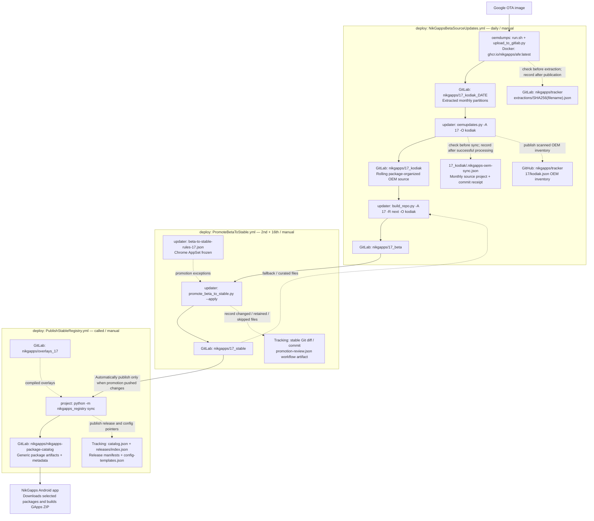

# NikGapps deployment pipeline

This repository orchestrates Google OEM extraction, source preparation,
beta-to-stable promotion, and publication of the packages consumed by the
NikGapps Android app. The examples below use **Android 17 / kodiak**;
`<android>`, `<device>` and `<date>` represent the selected target and dump date.

## Pipeline diagram

Solid arrows show processing/data flow. Dotted arrows show tracking, fallback
inputs or supporting dependencies. The three workflow groups are separate runs:
daily beta preparation does **not** immediately trigger stable promotion.



The beta updater also reads the existing `17_beta` tree when comparing sources.
The diagram's stable fallback does not mean every beta package is replaced by
stable: `next` applies package-specific comparison and companion-file strategies.

## Projects and repositories

| Project | Local checkout | Role |
| --- | --- | --- |
| GitHub `NikGappsOfficial/deploy` | `D:\workspace\docker\deploy` | Workflows, orchestration and registry rollback helper. |
| GitHub `nikgapps/oemdumps` | `D:\workspace\docker\oemdumps` | OTA discovery/download, partition extraction and monthly dump publication. |
| GitHub `nikgapps/updater` | `D:\workspace\python\updater` | Rolling OEM sync, beta preparation and beta-to-stable promotion. |
| GitHub `nikgapps/project` | `D:\workspace\python\project` | NikGapps package/AppSet definitions, build logic and registry publisher. |
| `niklibrary` | `D:\workspace\python\niklibrary` | Shared Git/GitLab, source-cloning and Android platform helpers. |
| NikGapps Android app | `D:\workspace\android\NikGapps` | Consumes published metadata/artifacts and assembles user-selected ZIPs. |

The updater installs the NikGapps Python package from its `requirements.txt`;
editing the local `project` checkout alone does not change that installed
dependency. The registry publication workflow, in contrast, clones `project`
from GitHub and runs its code directly.

### GitLab source and output repositories

| Repository | Contents / purpose |
| --- | --- |
| `nikgapps/<android>_<device>_<date>` | Monthly extracted Google dump, e.g. `17_kodiak_260905`. |
| `nikgapps/<android>_<device>` | Latest package-organized OEM source, e.g. `17_kodiak`. Not a second full OTA extraction. |
| `nikgapps/<android>_beta` | Candidate packages assembled from OEM, stable fallback and existing beta sources. |
| `nikgapps/<android>_stable` | Approved source files used for stable package publication. |
| `nikgapps/overlays_<android>` | Compiled overlays used during publication. |
| `nikgapps/nikgapps-package-catalog` | Generic package artifacts, catalog, release manifests and config templates consumed by the app. Default project ID: `85036487`. |
| `nikgapps/tracker` | Successful OEM extraction receipts. Separate from the GitHub tracker described below. |

## Workflows and execution boundaries

All links in this table point to workflows in this repository. Schedules are UTC.

| Workflow | Trigger | Processing / output |
| --- | --- | --- |
| [NikGapps Beta Source Updates](.github/workflows/NikGappsBetaSourceUpdates.yml) | Daily `01:00 UTC`, or manual | Resolves separate `android_version` and `device` inputs (defaults `17` and `kodiak`); extracts/reuses the latest OTA, syncs the rolling OEM repository, then prepares beta using `next`. |
| [Promote Beta Source to Stable](.github/workflows/PromoteBetaToStable.yml) | Days **2 and 16**, `09:00 UTC`, or manual | Runs `promote_beta_to_stable.py --android-version ... --apply`; pushes stable only when changed. Calls **Publish Stable Package Registry** only when that push occurred. |
| [Publish Stable Package Registry](.github/workflows/PublishStableRegistry.yml) | Manual, or reusable workflow call | Clones `project`, `<android>_stable` and `overlays_<android>`; builds package artifacts, uploads missing registry versions and publishes metadata/config templates. Default Android version: `17`. |
| [Roll Back Stable Package Registry](.github/workflows/RollbackStableRegistry.yml) | Manual | Validates a specified immediately preceding publication and optionally restores its metadata. `apply=false` is a dry run. Does not roll back stable source files. |

Daily source preparation currently invokes:

```sh
python3 oemupdates.py -A "$ANDROID_VERSION" -O "$DEVICE"
python3 build_repo.py -A "$ANDROID_VERSION" -R next -O "$DEVICE"
```

`refresh` and `swift` exist in updater, but are **not** the beta preparation case
selected by this workflow. Also, **NikGapps Beta Release** is a separate ZIP-build
workflow; it is not responsible for preparing `<android>_beta` source repositories.

## Tracking and repeat-run behavior

| Stage | Tracking location | Repeat-run behavior |
| --- | --- | --- |
| OTA extraction | **GitLab** `nikgapps/tracker`, `extractions/<SHA256-of-filename>.json` | `run.sh` checks the resolved OTA filename before extraction. A complete receipt skips extraction. `upload_to_gitlab.py` records success only after partition publication succeeds. Tracker access/validation errors are not treated as successful extraction. |
| Rolling OEM sync | GitLab `<android>_<device>/.nikgapps-oem-sync.json` | `SyncTracker` compares the selected monthly source project ID, commit and tracking rules version. Matching completion skips the OEM sync. The receipt is written after source/inventory processing succeeds in non-dev execution. |
| OEM inventory | **GitHub** `nikgapps/tracker`, e.g. `17/kodiak.json` | Stores the scanned OEM inventory used by updater. This is not the GitLab extraction receipt repository. |
| Beta preparation | Existing beta Git contents / commits | `next` compares source packages using its strategies. There is no separate whole-stage completion receipt in this workflow; skipping extraction/OEM sync does not skip beta preparation. |
| Stable promotion | Stable Git changes and `promotion-review.json` | The report lists upgraded, removed, retained and skipped files. No stable changes means no push and no automatic publication. The report is uploaded as an Actions artifact. |
| Registry publication | Existing Generic Registry package name/version pairs; catalog and release metadata | Existing artifact versions are reused rather than uploaded again. Release manifests pin selected package versions; `releases/index.json` identifies the active release. Artifact reuse does not itself mean the whole publication stage is skipped. |

### Promotion exclusions

Updater selects `beta-to-stable-rules-<android>.json` when present; otherwise it
uses `beta-to-stable-rules.json`. These files are alternatives, not merged layers.
Both the default and Android 17 files currently freeze the `GoogleChrome` AppSet:

```json
"appSets": {
  "GoogleChrome": "keep-stable"
}
```

This retains stable Chrome, TrichromeLibrary and WebViewGoogle, including their
companion files, and skips new beta-only members of the frozen AppSet. Individual
packages can be frozen with `"AppSet/Package": "keep-stable"` in `packages`.
Do not overlap an AppSet freeze with package/file rules inside that AppSet.

These exclusions affect **beta-to-stable promotion only**. Monthly extraction,
rolling OEM sync and beta preparation can still contain newer Chrome packages.
Intentional manual edits to stable can also still be published.

### Package releases versus config versions

A new package release does not necessarily require a new config version.
Config revisions track config entries and logical package/AppSet definitions
(names, membership, dependencies and selection flags), not APK bytes, APK
versions or APK-derived compatibility metadata. An APK-only release can retain
the existing config version, and unchanged package compatibility hashes are
preserved when migrating older metadata.

## Which workflow should I run?

- **New Google OTA / refresh beta:** run **NikGapps Beta Source Updates**, selecting
  the Android version and device. This does not promote stable immediately.
- **Promote reviewed beta packages:** run **Promote Beta Source to Stable**. It
  publishes the registry automatically if stable changed.
- **Publish manual stable fixes:** run **Publish Stable Package Registry**. Do not
  rerun promotion just to publish a manual stable edit.
- **Revert the app's active release:** use **Roll Back Stable Package Registry**
  after reviewing its predecessor-only validation. A registry rollback does not
  fix source files; correct/freeze the affected stable sources before republishing.

Commit and push changes to the repository actually cloned by a workflow before
running it. A local edit is not visible to GitHub Actions. The Android app reads
published registry metadata/artifacts, not the source repositories directly;
existing projects may remain pinned to their recorded release.

## Supporting workflows

- [Google Oem Dumps](.github/workflows/Dump-Docker.yml): standalone manual
  extraction using an OTA URL or device codename. It does not perform OEM sync,
  beta preparation or promotion.
- [NikGapps Android 17 Overlays](.github/workflows/NikGappsAndroid17Overlays.yml):
  separately builds/publishes Android 17 overlays; the registry publisher consumes
  the existing overlay repository, rather than triggering this workflow.
- [NikGapps Beta Release](.github/workflows/NikGappsBetaRelease.yml): separate
  beta ZIP-build workflow, not the beta-source preparation workflow above.
- In **oemdumps**, `.github/workflows/release.yml` creates extraction-tool releases
  and `.github/workflows/docker.yml` builds/pushes the extraction image on release
  publication or manual dispatch. `run.sh` also clones the oemdumps source at run
  time; changes to Docker-bundled tooling and the entrypoint require the image to
  be rebuilt.
